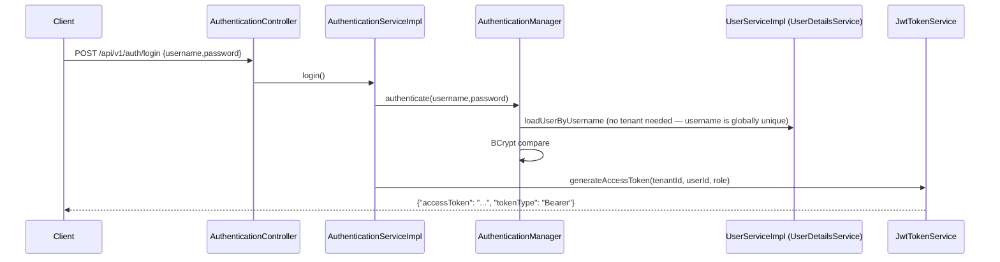
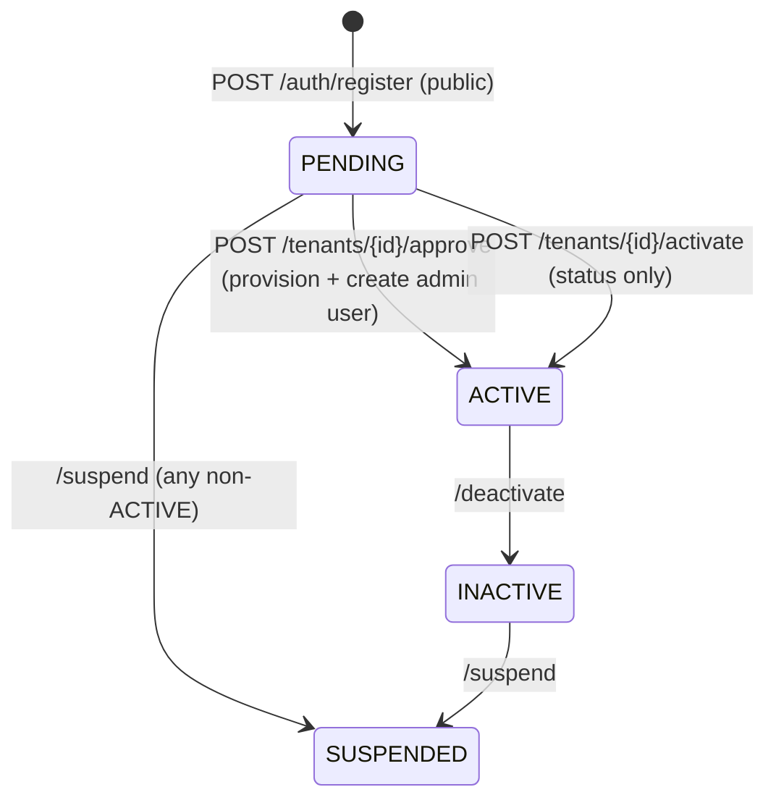
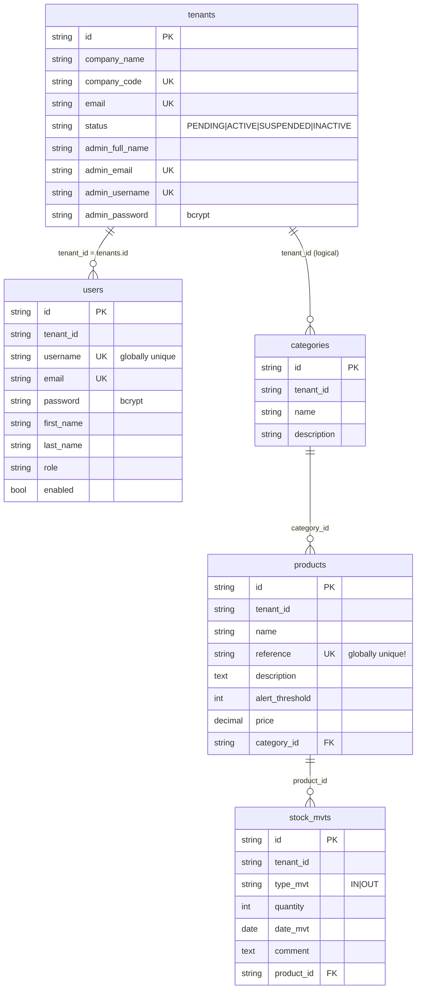

# Project Guide — Multi-tenant SaaS App

> **Read this first when you come back to the project.** It explains what the app does, which
> technologies it uses, how a request flows through the code, and where everything lives.
> Everything here was checked against the code and a running container on 2026-11-11.

---

## Table of contents

1. [What this project is (60-second version)](#1-what-this-project-is-60-second-version)
2. [Tech stack](#2-tech-stack)
3. [Run it](#3-run-it)
4. [Folder structure](#4-folder-structure)
5. [Spring Boot refresher — mapped to this code](#5-spring-boot-refresher--mapped-to-this-code)
6. [The request lifecycle (most important section)](#6-the-request-lifecycle-most-important-section)
7. [Multi-tenancy — how tenant data is kept apart](#7-multi-tenancy--how-tenant-data-is-kept-apart)
8. [Authentication, JWT and roles](#8-authentication-jwt-and-roles)
9. [Tenant lifecycle — register → approve → use](#9-tenant-lifecycle--register--approve--use)
10. [Data model](#10-data-model)
11. [API reference](#11-api-reference)
12. [Error handling](#12-error-handling)
13. [Configuration & environment variables](#13-configuration--environment-variables)
14. [Docker setup explained](#14-docker-setup-explained)
15. [Known issues & gotchas (verified)](#15-known-issues--gotchas-verified)
16. [Recipe: adding a new feature](#16-recipe-adding-a-new-feature)
17. [Other docs in the repo](#17-other-docs-in-the-repo)

---

## 1. What this project is (60-second version)

A **REST API backend** for a multi-tenant **inventory / stock management** SaaS.

- A **tenant** = one company (e.g. "Acme Corporation").
- Each company manages its own **categories → products → stock movements** (stock IN / OUT).
- Many companies share **one database and the same tables**. Every row carries a `tenant_id`
  column, and Hibernate automatically adds `WHERE tenant_id = ?` to every query so one company
  can never see another's data. This is called **"filter mode"** (shared schema, discriminator column).
- Users log in with username/password and receive a **JWT** (signed with an RSA key pair).
  The JWT contains the user's `tenant_id` and `role`.
- Every business request must send **`Authorization: Bearer <jwt>`** and **`X-Tenant-ID: <tenant uuid>`**.
- New companies **self-register** (status `PENDING`), and a platform admin **approves** them, which
  creates their first admin user.

---

## 2. Tech stack

| Area | Technology | Version | Where it shows up |
|---|---|---|---|
| Language | Java | 21 | `pom.xml` → `java.version` |
| Framework | Spring Boot | 4.0.6 | `pom.xml` parent |
| Web | Spring Web MVC (`spring-boot-starter-webmvc`) | — | `controllers/` |
| Security | Spring Security (stateless, method security) | — | `security/SecurityConfig.java` |
| Tokens | JJWT (`io.jsonwebtoken`), **RS256** (RSA) | 0.12.6 | `security/JwtTokenService.java` |
| Persistence | Spring Data JPA + Hibernate | — | `repositories/`, `entities/` |
| Database | PostgreSQL | 17.5 (Docker) | `docker-compose.yml` |
| DB migrations | Flyway (+ `flyway-database-postgresql`) | — | `src/main/resources/db/migration/` |
| Validation | Jakarta Bean Validation (`spring-boot-starter-validation`) | — | `dto/request/*` (`@NotBlank`, `@Size`…) |
| AOP | Spring AOP / AspectJ annotations | — | `config/TenantHibernateFilter.java` |
| Caching | Spring Cache, in-memory `ConcurrentMapCacheManager` | — | `config/CacheConfig.java` |
| API docs | springdoc-openapi (Swagger UI) | 3.0.2 | `config/OpenApiConfig.java` |
| Boilerplate | Lombok (`@Getter`, `@Builder`, `@RequiredArgsConstructor`…) | — | everywhere |
| Password hashing | BCrypt (`BCryptPasswordEncoder`, strength 10) | — | `config/BeansConfig.java` |
| Build | Maven (wrapper `./mvnw`) | — | `pom.xml`, `mvnw` |
| Containers | Docker (multi-stage, Alpine), Docker Compose | — | `Dockerfile`, `docker-compose.yml` |
| Dev only | spring-boot-devtools, spring-boot-docker-compose, H2 | — | `pom.xml` |

**Not used (yet):** no Redis, no message queue, almost no tests (only the default
`MultiTanantSaasAppApplicationTests` context-load test + `src/test/resources/application-test.yml`), no MapStruct
(mappers are hand-written), no refresh tokens.

---

## 3. Run it

### Option A — Docker (recommended, works from a clean clone, no `.env` needed)

```bash
docker compose up --build -d      # first build ≈ 10+ min (Maven downloads deps), later builds are fast
docker compose ps                 # saas-app should become "healthy"
docker compose logs -f app        # follow app logs
docker compose down               # stop (keeps DB data)
docker compose down -v            # stop AND wipe the database volume
```

| What | URL |
|---|---|
| Swagger UI | http://localhost:8080/swagger-ui/index.html |
| OpenAPI JSON | http://localhost:8080/api-docs |
| Health | http://localhost:8080/api/v1/health |
| Postgres | `localhost:5432`, db `saas-db`, user `postgres`, password `postgres` |

Shell inside the container: `docker exec -it saas-app sh` · DB shell: `docker exec -it saas-db psql -U postgres -d saas-db`

### Option B — run on the host (IntelliJ / `./mvnw spring-boot:run`)

1. Start only Postgres: `docker compose up -d postgres`
2. Create JWT keys once (Docker's `keygen` service also does this into `./certs`):
   ```bash
   openssl genrsa -out certs/private_key.pem 2048
   openssl rsa -in certs/private_key.pem -pubout -out certs/public_key.pem
   ```
3. Run `MultiTanantSaasAppApplication`. Defaults in `application.yml` point to `localhost:5432`.
   Set `SPRING_DOCKER_COMPOSE_ENABLED=false` if Spring Boot tries to start the compose file itself
   (the `spring-boot-docker-compose` dependency is on the classpath).

### Demo data (seeded by Flyway V3/V4)

| | Value |
|---|---|
| Tenant | Acme Corporation, code `acme-corp`, **id `556e48ea-8f76-4d56-8517-4c3c0a8f6db4`** |
| User | `admin` / `SecurePassword123`, role `ROLE_PLATFORM_ADMIN` |

### Try it (copy-paste, verified)

```bash
B=http://localhost:8080/api/v1
T=556e48ea-8f76-4d56-8517-4c3c0a8f6db4

# 1. login → JWT
TOK=$(curl -s -X POST $B/auth/login -H 'Content-Type: application/json' \
  -d '{"username":"admin","password":"SecurePassword123"}' | sed -E 's/.*"accessToken":"([^"]+)".*/\1/')

# 2. create a category (200)
curl -X POST $B/categories -H "Authorization: Bearer $TOK" -H "X-Tenant-ID: $T" \
  -H 'Content-Type: application/json' -d '{"name":"Electronics","description":"demo"}'

# 3. list categories (200, paged JSON)
curl "$B/categories?page=0&size=10" -H "Authorization: Bearer $TOK" -H "X-Tenant-ID: $T"
```

A Postman collection lives at `docs/postman/MultiTanant_SAAS_API.postman_collection.json`.

---

## 4. Folder structure

```
Multi-tenant-saas-app/
├── pom.xml                      # dependencies & build
├── Dockerfile                   # multi-stage: JDK build → JRE runtime, non-root user
├── docker-entrypoint.sh         # finds/writes JWT keys, then exec java (PID 1)
├── docker-compose.yml           # keygen + postgres + app
├── .env.example                 # every env var, documented (copy to .env — optional)
├── certs/                       # JWT PEM keys (git-ignored, generated)
├── docs/                        # older design docs, diagrams, Postman collection
└── src/main/
    ├── resources/
    │   ├── application.yml              # ALL config, with ${ENV:default} placeholders
    │   ├── application-dev.yaml         # empty placeholder for dev overrides
    │   └── db/migration/
    │       ├── common/  V1..V5           # run at startup (public schema) ← the real schema
    │       └── tenant/  V1               # only for schema-per-tenant provisioning (see §7)
    └── java/com/ashish/saas/multitanantsaasapp/
        ├── MultiTanantSaasAppApplication.java   # main()
        ├── auth/          # /auth/login, /register, /logout + AuthenticationService
        ├── controllers/   # REST endpoints (Category, Product, StockMvt, Tenant, User, Health)
        ├── services/      # interfaces (BasicService<I,O> = generic CRUD contract)
        │   └── impl/      # business logic — ALL @Transactional (required, see §7)
        ├── repositories/  # Spring Data JPA interfaces (JpaRepository)
        ├── entities/      # JPA entities; all extend AbstractEntity (id, tenant_id, audit, deleted)
        ├── dto/request    # incoming JSON + validation annotations
        ├── dto/response   # outgoing JSON
        ├── mapper/        # hand-written entity ⇄ DTO converters
        ├── config/        # tenant plumbing, caching, auditing, OpenAPI, beans
        ├── security/      # SecurityConfig, JWT filter/service, 401/403 handlers
        ├── exception/     # GlobalExceptionHandler, AppException, ApiError
        └── common/        # PageResponse<T>
```

**Layering rule:** `Controller → Service (interface) → ServiceImpl → Repository → Entity`.
Controllers only take DTOs and return DTOs; mappers convert; entities never leave the service layer.

---

## 5. Spring Boot refresher — mapped to this code

If you forgot Spring Boot itself, this is the minimum you need, with the file where each idea is used.

| Concept | What it means | In this project |
|---|---|---|
| **Bean / DI** | Spring creates objects (`@Component`, `@Service`, `@RestController`, `@Configuration` + `@Bean`) and injects them into constructors. | Lombok `@RequiredArgsConstructor` generates the constructor for `private final` fields → that is how everything gets injected. |
| **Auto-configuration** | Adding a starter to `pom.xml` configures it automatically (DataSource, JPA, Flyway, Security…). | DB settings in `application.yml` are enough to get a connection pool (HikariCP), Hibernate and Flyway. |
| **Externalized config** | `${ENV_VAR:default}` in YAML reads env vars with a fallback. | Every setting in `application.yml`. `@ConfigurationProperties` binds `app.jwt.*` → `JwtProperties`. |
| **Profiles** | `SPRING_PROFILES_ACTIVE=dev` loads `application-dev.yaml` on top. | Default profile is `dev`. |
| **Servlet Filter** | Code that runs around every HTTP request, before controllers. | `TenantFilter` (reads `X-Tenant-ID`), `JwtAuthenticationFilter` (reads JWT). |
| **Security filter chain** | Spring Security's list of filters + URL rules. | `SecurityConfig.securityFilterChain()` |
| **Method security** | `@PreAuthorize("hasRole('X')")` on controller methods. | `TenantController`, `UserController` (enabled by `@EnableMethodSecurity`). |
| **AOP aspect** | Code run automatically before/after matching methods. | `TenantHibernateFilter` runs `@Before` every method in `services.impl.*`. |
| **@Transactional** | Opens a DB transaction (and Hibernate session) around a method. | Every `*ServiceImpl` class. |
| **JPA entity / repository** | `@Entity` class ↔ table; `interface XRepo extends JpaRepository<X, String>` gives CRUD for free; method names like `findByUsername` become queries. | `entities/`, `repositories/` |
| **Hibernate filter** | A named SQL condition (`@FilterDef` + `@Filter`) you can switch on per session. | `tenantFilter` in `AbstractEntity` + `@Filter` on each entity. |
| **JPA auditing** | `@CreatedDate`, `@CreatedBy`… filled automatically. | `JpaAuditingConfig` (auditor = user id from the JWT). |
| **Flyway** | Versioned SQL scripts run once at startup, tracked in `flyway_schema_history`. | `db/migration/common/V1..V5`. **Never edit an applied script — add `V6__...sql`.** `ddl-auto: none`, so Hibernate never changes the schema. |
| **@RestControllerAdvice** | One place converting exceptions → HTTP responses. | `GlobalExceptionHandler` |

---

## 6. The request lifecycle (most important section)

Example: `GET /api/v1/products?page=0&size=10` with a JWT and `X-Tenant-ID`.

```mermaid
sequenceDiagram
    autonumber
    participant C as Client
    participant TF as TenantFilter<br/>(servlet filter, HIGHEST_PRECEDENCE)
    participant SEC as Spring Security chain
    participant JF as JwtAuthenticationFilter
    participant CT as ProductController
    participant TX as @Transactional proxy
    participant AOP as TenantHibernateFilter (AOP)
    participant S as ProductServiceImpl
    participant R as ProductRepo / Hibernate
    participant DB as PostgreSQL

    C->>TF: GET /api/v1/products + Authorization + X-Tenant-ID
    TF->>TF: exempt path? (auth, health, swagger) → skip
    TF->>TF: header missing → 400, bad format → 400
    TF->>TF: TenantContext.setCurrentTenant(header), MDC tenantId
    TF->>SEC: chain.doFilter
    SEC->>JF: before UsernamePasswordAuthenticationFilter
    JF->>JF: verify RS256 signature with public key
    JF->>JF: read sub=userId, tenant_id, role from claims
    JF->>JF: TenantContext.setCurrentTenant(token tenant) ← overrides header
    JF->>JF: SecurityContext = authenticated(userId, role)
    SEC->>SEC: URL rule: not public → must be authenticated, else 401
    SEC->>CT: dispatch
    CT->>TX: productService.findAll(page,size)
    TX->>TX: open transaction + Hibernate session
    TX->>AOP: @Before advice
    AOP->>AOP: no tenant → throw; no tx → throw
    AOP->>AOP: session.enableFilter("tenantFilter", tenantId)
    AOP->>S: proceed
    S->>R: productRepository.findAll(pageRequest)
    R->>DB: SELECT ... WHERE tenant_id = ? AND deleted = false LIMIT ?
    DB-->>S: rows of THIS tenant only
    S-->>CT: PageResponse<ProductResponse> (via ProductMapper)
    CT-->>C: 200 JSON
    Note over TF,JF: finally{} blocks clear TenantContext (ThreadLocal) + MDC
```

Step-by-step in words:

1. **`TenantFilter`** (`config/TenantFilter.java`) runs first for every request. It skips
   `/api/v1/auth/**`, health, Swagger and `/error`. For everything else it requires
   `X-Tenant-ID` (lowercased, must match `^[a-z0-9_-]{2,50}$`) and stores it in
   **`TenantContext`**, a `ThreadLocal` holder (`config/TenantContext.java`).
2. **`JwtAuthenticationFilter`** (`security/JwtAuthenticationFilter.java`) reads
   `Authorization: Bearer …`, validates it with the **public key**, and puts the user into
   Spring Security's `SecurityContext`. It **also writes the token's `tenant_id` into
   `TenantContext`, so the token wins over the header**. Invalid/expired token → no
   authentication → **401** from `RestAuthenticationEntryPoint`.
3. **`SecurityConfig`** URL rules: `PUBLIC_URLS` + `OPTIONS` are open; everything else needs
   authentication. Then `@PreAuthorize` on controller methods checks roles (403 if wrong).
4. **Controller** validates the body (`@Valid` → 400 with `fieldErrors`) and calls the service.
5. **`@Transactional`** on the service opens a transaction first, because
   `TransactionAdviceOrderConfig` pins the transaction advisor to the highest precedence (outermost).
6. **`TenantHibernateFilter`** (AOP, lowest precedence = innermost) enables Hibernate's
   `tenantFilter` on the *current* session with the tenant id. It **fails loudly** if there is no
   tenant or no transaction, because either would silently return every tenant's rows.
7. **Repository** query → Hibernate appends `tenant_id = :tenantId AND deleted = false`.
8. On insert, **`AbstractEntity.onCreate()`** (`@PrePersist`) fills `tenant_id` from
   `TenantContext`, sets `deleted=false`, and throws if no tenant is known.
9. The mapper converts entity → response DTO, and the controller returns it.
10. Any exception → **`GlobalExceptionHandler`** → uniform `ApiError` JSON (§12).

---

## 7. Multi-tenancy — how tenant data is kept apart

Switched by `app.tenant.mode` (env `TENANT_MODE`):

| Mode | Status | How it works |
|---|---|---|
| **`filter`** (default) | ✅ **Implemented & used** | One schema (`public`), every table has `tenant_id`. Beans active: `TenantFilter`, `TenantHibernateFilter`. |
| `schema` | ❌ **Not implemented end-to-end** | Would route each tenant to its own Postgres schema `tenant_<company_code>` via `SET search_path`. Beans: `MultiTenantConnectionProviderImpl`, `CurrentTenantIdentifierResolverImpl`. Selecting it **turns off** the filter beans → **no isolation at all**. Don't use it. See `docs/tenant-toggle.md`. |

### The four rules filter mode depends on (break one → data leak)

1. `@FilterDef(name="tenantFilter", …)` is declared once on `AbstractEntity`.
2. **`@Filter(name="tenantFilter")` must be on every concrete `@Entity`**. Hibernate ignores
   it on a `@MappedSuperclass`. (`Tenant` deliberately has none.)
3. **Every `*ServiceImpl` must be `@Transactional`**, or the filter is enabled on a throwaway session.
4. Service methods must live in `services.impl.*`, because that is the AOP pointcut.

Exempt methods that legitimately run without a tenant (listed in `TenantHibernateFilter`):
`loadUserByUsername` (login), `registerTenant` (public signup), `provisionTenant` (raw DDL).

> **Important:** a filter only affects **JPQL/HQL/Criteria queries**. `findById` /
> `entityManager.find` load by primary key and **bypass Hibernate filters**. Since ids are random
> UUIDs this is hard to exploit, but it is a real gap (see §15).

### What is "the tenant id"?

It is the **`tenants.id` UUID** (e.g. `556e48ea-…`). Users store it in `users.tenant_id`, the JWT
carries it as `tenant_id`, and that is what you send as `X-Tenant-ID`. (A `Tenant` row's *own*
`tenant_id` column is set to its lowercase company code on registration, which is unrelated.)

`TenantSchemaResolver` maps tenant id → schema name `tenant_<code>` (cached in `tenantSchemas`).
It is only meaningful in schema mode, but the JWT filter calls it on every authenticated request.

---

## 8. Authentication, JWT and roles

### Login flow



- `User` implements Spring's `UserDetails`; authority = role name (e.g. `ROLE_COMPANY_ADMIN`).
- **JWT claims:** `sub` = user id, `tenant_id`, `role`, `iss` = `stock-saas-app`, `exp` (default 24 h).
- **Signing:** RS256. The private key signs and the public key verifies. Keys are PEM files loaded via
  Spring `ResourceLoader` from `JWT_PRIVATE_KEY_PATH` / `JWT_PUBLIC_KEY_PATH` (needs `file:` prefix).
- **Logout** is a no-op (stateless JWT): the client just discards the token. There are no refresh tokens.
- **CORS:** all origins, methods and headers allowed with credentials (`SecurityConfig`). Tighten this for prod.

### Roles (`entities/UserRole.java`)

| Role | Intended for |
|---|---|
| `ROLE_PLATFORM_ADMIN` | You, the SaaS owner. Sees/approves tenants. Seeded user `admin`. |
| `ROLE_COMPANY_ADMIN` | First user of a company, created on approval. Manages that company's users. |
| `ROLE_ADMINISTRATOR` | Company-level admin helper. |
| `ROLE_USER`, `ROLE_SALES_OPERATOR` | Regular company staff. |

`hasRole('X')` checks for authority `ROLE_X`, which is why the enum values carry the `ROLE_` prefix.
Categories, products and stock movements have **no role checks**: any authenticated user of the tenant can use them.

---

## 9. Tenant lifecycle — register → approve → use



1. **Register** (`POST /api/v1/auth/register`, no auth, no tenant header): `TenantServiceImpl.registerTenant`
   checks that the company code and email are unique, BCrypt-hashes `adminPassword`, and saves the tenant as `PENDING`.
2. **Approve** (`POST /api/v1/tenants/{id}/approve`): sets the tenant `ACTIVE`, then
   - `ProvisioningServiceImpl.provisionTenant` creates the schema `tenant_<code>` and runs
     `db/migration/tenant` Flyway into it. This is leftover schema-mode work; in filter mode those tables are unused.
   - `createAdminUser`: creates a `ROLE_COMPANY_ADMIN` user from the stored admin fields, with
     `tenant_id = tenant.id`.
   - On failure: drops the schema, puts the status back to `PENDING`, and returns 500.
3. The new company admin logs in and gets a JWT with their tenant id, then uses the API with
   `X-Tenant-ID: <that tenant id>`.

---

## 10. Data model

All tables live in the `public` schema and are created by Flyway `common/V1..V5`.
Every table has the `AbstractEntity` columns: `id` (UUID string PK), `tenant_id`, `created_at`, `updated_at`,
`created_by`, `updated_by`, `deleted` (soft delete).



Migrations:

| File | Does |
|---|---|
| `V1__init_Common_tables.sql` | `tenants`, `users` (+ unique constraints, FK) |
| `V2__add_enum_checks.sql` | CHECK constraints for status/role |
| `V3__seed_demo_data.sql` | Acme tenant + `admin` user |
| `V4__fix_demo_admin_password.sql` | sets the admin password to `SecurePassword123` |
| `V5__init_tenant_business_tables.sql` | `categories`, `products`, `stock_mvts` + `tenant_id` indexes |
| `tenant/V1__init_For_tenat_DB.sql` | same business tables, only run into `tenant_<code>` schemas on approval |

---

## 11. API reference

Base path `/api/v1`. Unless marked *public*, send `Authorization: Bearer <jwt>` **and** `X-Tenant-ID`.
Lists take `?page=0&size=10` and return `PageResponse` (`content, page, size, totalElements,
totalPages, hasNext, hasPrevious, first, last`). Create/update/delete return `200` with an empty body.

| Method & path | Who | Notes |
|---|---|---|
| `GET /health` (also `/health`) | public | status, DB status, uptime |
| `POST /auth/login` | public | `{username, password}` → `{accessToken, tokenType}` |
| `POST /auth/register` | public | `{companyName, companyCode, email, adminFullName, adminEmail, adminUsername, adminPassword}` |
| `POST /auth/logout` | public | no-op |
| `POST/GET/PUT/DELETE /categories[/{id}]` | any authenticated | `{name (2–100), description}` |
| `POST/GET/PUT/DELETE /products[/{id}]` | any authenticated | `{name, reference, description, alertThreshold ≥0, price ≥0, categoryId}` |
| `POST/GET/PUT/DELETE /stock-mvts[/{id}]` | any authenticated | `{typeMvt: IN\|OUT, quantity >0, dateMvt: yyyy-MM-dd, comment, productId}` |
| `GET /tenants` | any authenticated ⚠️ | all tenants |
| `GET /tenants/pending` | PLATFORM_ADMIN, ADMINISTRATOR | pending tenants |
| `POST /tenants/{id}/approve \| activate \| deactivate \| suspend` | any authenticated ⚠️ | see §9 |
| `POST /users`, `PUT/DELETE /users/{id}`, `POST /users/{id}/enable\|disable` | COMPANY_ADMIN | create is broken, see §15 |
| `GET /users`, `GET /users/{id}` | COMPANY_ADMIN, ADMINISTRATOR | scoped to the caller's tenant |
| `GET /users/roles` | PLATFORM_ADMIN, COMPANY_ADMIN, ADMINISTRATOR | |

---

## 12. Error handling

`exception/GlobalExceptionHandler.java` turns every exception into:

```json
{
  "timestamp": "2026-11-11T14:57:56Z",
  "status": 404,
  "error": "Not Found",
  "message": "Product not found",
  "path": "/api/v1/products/123",
  "traceId": null,
  "details": { "code": "PRODUCT_NOT_FOUND" }
}
```

| Exception | HTTP |
|---|---|
| `MethodArgumentNotValidException` (bad `@Valid` body) | 400, `details.fieldErrors[]` |
| malformed JSON, missing/mismatched params | 400 |
| `AuthenticationException` / `UnauthorizedException` | 401 |
| `AccessDeniedException` | 403 |
| `AppException(status, code, message)` ← **throw this for business errors** | whatever status you pass |
| `DataIntegrityViolationException`, `DuplicateKeyException` | 409 |
| `NoResourceFoundException` | 404 |
| anything else | 500 "Unexpected error" (full stack trace in logs) |

Two responses do **not** use this format: `TenantFilter`'s missing/invalid header errors are
written directly as `{"error": "..."}` (400), and 401/403 from the security chain come from
`RestAuthenticationEntryPoint` / `RestAccessDeniedHandler`.

---

## 13. Configuration & environment variables

Everything is in `src/main/resources/application.yml` as `${ENV:default}`, so the app runs with
zero env vars against a local Postgres. Full documented list: `.env.example`.

| Env var | Default | Meaning |
|---|---|---|
| `SPRING_PROFILES_ACTIVE` | `dev` | profile |
| `SERVER_PORT` | `8080` | port (in Docker: the host port) |
| `DB_HOST` / `DB_PORT` | `localhost` / `5432` | Compose forces `postgres` / `5432` |
| `DB_NAME` / `DB_USER` / `DB_PASSWORD` | `saas-db` / `postgres` / `postgres` | **change the password in prod** |
| `DB_TZ` | `Asia/Kolkata` | JDBC session + container timezone |
| `TENANT_MODE` | `filter` | keep `filter` (§7) |
| `JWT_PRIVATE_KEY_PATH` / `JWT_PUBLIC_KEY_PATH` | `file:./certs/…pem` | key files |
| `JWT_PRIVATE_KEY` / `JWT_PUBLIC_KEY` | — | key *content* (PEM or base64), written to disk by the entrypoint (ECS/Fargate) |
| `JWT_ACCESS_TOKEN_EXPIRATION` | `86400000` | token lifetime in ms (24 h) |

Other notable settings: `show-sql: true` (every SQL statement is logged), `open-in-view: false`,
Hikari pool size 10, JDBC batch size 20.

---

## 14. Docker setup explained

`docker-compose.yml` runs three services on network `saas-app-network`:

1. **`keygen`**: one-shot. Uses the app image to create `./certs/private_key.pem` +
   `public_key.pem` with openssl if they're missing, then exits. Keys live on the host, so tokens survive rebuilds.
2. **`postgres`** (`postgres:17.5`): data in volume `postgres_data`, with a `pg_isready` healthcheck.
3. **`app`**: starts only after Postgres is healthy and keygen has finished. It mounts `./certs` read-only and
   gets a healthcheck on `/api/v1/health`. `.env` is **optional**; without it every variable falls back to
   the defaults above.

`Dockerfile`:
- **Build stage** `eclipse-temurin:21-jdk-alpine`: copies `pom.xml` first and runs
  `dependency:go-offline`, so dependencies are cached as a layer. Then it copies `src/` and runs `package -DskipTests`.
- **Runtime stage** `eclipse-temurin:21-jre-alpine`: copies only the jar, runs as non-root `appuser`, and sets
  `JAVA_OPTS` for container-aware memory (`MaxRAMPercentage=75`).

`docker-entrypoint.sh`: if `JWT_PRIVATE_KEY`/`JWT_PUBLIC_KEY` env vars are set, it writes them to
`/app/certs`; otherwise it expects mounted files, and refuses to start without keys. Then `exec java`,
so the JVM is PID 1 and receives SIGTERM for a clean shutdown.

---

## 15. Known issues & gotchas (verified)

Things that will surprise you. ✅ = reproduced against the running app.

1. ✅ **`POST /api/v1/users` always returns 500.** `UserRequest.role` is an enum annotated with
   `@NotBlank`, which only works on strings → `UnexpectedTypeException HV000030`.
   **Fix:** change it to `@NotNull`.
2. **Tenant admin endpoints are not role-protected.** In `TenantController` only `/pending` has
   `@PreAuthorize`. `GET /tenants` and `approve/activate/deactivate/suspend` work for *any* logged-in user of any tenant.
   **Fix:** add `@PreAuthorize("hasRole('PLATFORM_ADMIN')")` to the class.
3. **The seeded `admin` (PLATFORM_ADMIN) can't manage users.** `UserController` has a class-level
   `hasRole('PLATFORM_ADMIN')`, but every method overrides it with `COMPANY_ADMIN` (method-level
   annotations win). Approve a tenant and log in as its company admin to test `/users`.
4. **`X-Tenant-ID` is required but effectively ignored** when a JWT is present: the JWT filter
   overwrites `TenantContext` with the token's tenant, and nothing checks that the two match. Send the same value as your token's `tenant_id`.
5. **`findById` bypasses the Hibernate tenant filter** (filters don't apply to primary-key loads).
   A user who knows another tenant's product/category UUID could read, update or delete it. **Fix:** query with
   `findByIdAndTenantId` or check `entity.getTenantId()` after loading.
6. **`products.reference` is unique across all tenants** (`uc_products_reference`). Two companies
   can't both have product `SKU-1`; the second gets 409 "Data integrity violation". Should be `UNIQUE(tenant_id, reference)`.
7. **Product delete is a hard delete** (soft delete is commented out in `ProductServiceImpl.delete`),
   while categories, stock movements and users are soft-deleted. Deleting a product that has stock movements → 409 (FK).
8. **`users` has an unused `"tenant id"` column** (with a space) holding the FK constraint. JPA writes
   `tenant_id` instead (`@JoinColumn(name="tenant_id", insertable=false…)`), so the FK isn't enforced for new users.
9. **Approval creates a `tenant_<code>` schema** with tables that filter mode never uses.
10. **The schema-resolver cache never expires** (`ConcurrentMapCacheManager`), and is per-instance.
11. **Practically no tests**: only the generated context-load test exists, and the Docker build uses `-DskipTests`.
12. **Package name typo** `multitanantsaasapp` / `MultiTanant…` is used everywhere. Leave it unless you do a full rename.

---

## 16. Recipe: adding a new feature

Example: a `Supplier` entity per tenant.

1. **Migration**: `src/main/resources/db/migration/common/V6__create_suppliers.sql` with the
   `AbstractEntity` columns (`id, tenant_id, created_at, updated_at, created_by, updated_by, deleted`)
   plus an index on `tenant_id`. (Also add it to `tenant/` if you ever revive schema mode.)
2. **Entity**: `entities/Supplier.java`
   ```java
   @Entity @Table(name = "suppliers")
   @Filter(name = "tenantFilter")              // ← mandatory, or you leak data
   @Getter @Setter @SuperBuilder @NoArgsConstructor @AllArgsConstructor
   public class Supplier extends AbstractEntity { ... }
   ```
3. **Repository**: `interface SupplierRepo extends JpaRepository<Supplier, String>`
4. **DTOs**: `dto/request/SupplierRequest` (with validation; use `@NotNull` for enums/numbers, not `@NotBlank`)
   and `dto/response/SupplierResponse`.
5. **Mapper**: `mapper/SupplierMapper` (`toEntity`, `toResponse`).
6. **Service**: `services/SupplierService extends BasicService<SupplierRequest, SupplierResponse>`, plus
   `services/impl/SupplierServiceImpl` annotated **`@Service @Transactional`** (it must be in `services.impl`).
   Throw `new AppException(HttpStatus.NOT_FOUND, "SUPPLIER_NOT_FOUND", "...")` for errors.
7. **Controller**: `controllers/SupplierController`, `@RequestMapping("api/v1/suppliers")`, `@Valid` bodies,
   `@PreAuthorize` if needed, `@Tag`/`@Operation` for Swagger.
8. Rebuild: `docker compose up --build -d`, then test in Swagger.

---

## 17. Other docs in the repo

| File | Content |
|---|---|
| `docs/v2/01-project-overview.md` … `05-open-questions.md` | longer design write-ups |
| `docs/v2/diagrams/*.png` | request lifecycle, tenant resolution, ER, package map, system map |
| `docs/tenant-toggle.md` | filter vs schema mode in depth |
| `docs/tenant-header-flow.md`, `docs/flow.md` | tenant header / request flow |
| `docs/global-exception-handler.md` | error handling details |
| `docs/postman/…collection.json` | ready-made API requests |
| `FIX.md`, `prompt.md` | history of past fixes / notes |

If one of those disagrees with this guide, **trust the code** and then this file.
